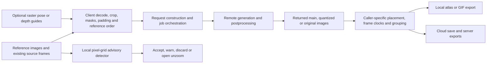

# Where the recovered method ends

The investigation explains shipped client methods and retained service observations. It does not recover a server merely by decompiling the website or extension. This distinction controls what another AI can honestly reuse in a later local reconstruction.

The source reports recover concrete branches in B, C, F, H, J and K. Their exact formulas and caller differences are supported by hashes, line/byte anchors, inert scene decoding and selected independent reviews. Some guide graphics are **previews only**; a visible guide must not be assumed to be a submitted conditioning image. Transport routing, skip-first placement and palette selection are not neural motion algorithms.

For D, request fields and response images establish a service interface and bounded observations. They do not establish segmentation, attention, latent encoders, training data, samplers, temporal constraints or actual checkpoint identity. The captured official API attributes a MiniMax animation route to the H3 family; the [model identity analysis](../analysis-models/MODEL-IDENTITY-RESEARCH.md) separates that disclosure from an unproven deployment checkpoint or adapter. Selector strings, shared seeds and a palette match are insufficient to fill those gaps.

For I, the browser's request construction and client persistence projection are recoverable. Server transaction ordering, retention, cancellation, entity grouping and engine-package construction are not recovered from the client request. The map exporter saves state and downloads a server artifact; the browser's rendered PNG and placement schema do not prove a local Godot/Unity packager.

A reusable deterministic stage specification can therefore be documented from these sources. A faithful local **generator** and high-quality animated sprite system still require separate implementation and evaluation after the analysis phase. The current work contains no replacement inference system, no new art/animation test, and no claimed visual-quality score. [CURRENT-ANALYSIS.md](../CURRENT-ANALYSIS.md) links the exact evidence, corrections and remaining scopes.

Additional public disclosures are now recorded in the [MCP art/model report](../analysis-models/depth-round2/mcp-art-workbench-disclosure/MCP-ART-WORKBENCH-DISCLOSURE.md): a historical vendor-linked SDXL card/config and documented workbench interfaces. The card/config is a positive historical disclosure, not proof of current deployment, tensor inspection or the service's animation training. UNet channel configuration does not identify the client raw-RGBA wire format. The 116 MCP headings and seven resource names expand the documentation inventory; they are not recovered handler implementations.
